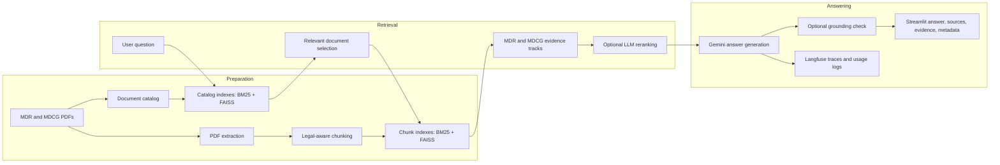

# MDR / MDCG Regulatory RAG Assistant

Thesis prototype for evidence-grounded question answering over the EU Medical Device Regulation (MDR 2017/745) and Medical Device Coordination Group (MDCG) guidance.

The system retrieves local regulatory evidence, generates an answer with Gemini, and exposes the supporting chunks and source metadata for human verification. It is an educational research prototype—not legal advice or a certified regulatory decision system.

## At a glance

| | |
|---|---|
| **Problem** | Regulatory answers must be traceable to the MDR and relevant MDCG guidance |
| **Approach** | Two-stage, hybrid retrieval followed by evidence-constrained generation |
| **Stack** | Python, FAISS, BM25, FastEmbed, Gemini, Streamlit, Langfuse |
| **Retrieval** | 60% lexical BM25 + 40% dense similarity at document and chunk level |
| **Guardrails** | Source validation, bounded retries, optional evidence and grounding checks |

## Architecture



## Why this design

### Two-stage retrieval

The first stage identifies relevant regulatory documents before searching inside their content. This reduces noise when the MDCG collection is large and preserves a separate MDR evidence track as the binding legal basis.

### Hybrid search

BM25 captures exact legal phrases, article numbers, and guidance references. Dense retrieval captures semantically related language. Both score sets are normalized and combined with a 0.6 / 0.4 weighting.

### Bounded recovery

The pipeline allows at most three retrieval attempts. A later attempt uses a different catalog slice and a different pool of directly retrieved MDCG chunks, improving recall without creating an uncontrolled loop.

### Traceability and observability

The UI returns source labels, document metadata, chunk IDs, page ranges, retrieval scores, and evidence text. Optional Langfuse tracing records retrieval, reranking, answer generation, source-support metadata, and external-access summaries.

## Engineering highlights

- Built legal-structure chunking for MDR Articles and Annexes.
- Implemented document-level and chunk-level BM25 / FAISS indexes.
- Kept MDR and MDCG evidence as separate retrieval tracks before final context selection.
- Added optional LLM reranking, evidence-sufficiency checks, and grounding checks.
- Added controlled source-based fallback behavior for Gemini quota failures.
- Added runtime monitoring for unexpected external access.
- Protected the Streamlit demonstration with a constant-time password comparison.
- Centralized prompts in version-controlled text files for review and iteration.

## Project map

```text
src/
├── chunk_documents.py           # Extract and chunk MDR / MDCG PDFs
├── catalog_builder.py           # Build the document-level catalog
├── build_index.py               # Build BM25 and FAISS indexes
├── catalog_retrieve.py          # Stage 1: document retrieval
├── retrieve.py                  # Stage 2: evidence retrieval
├── llm_rerank.py                # Optional Gemini reranking
├── generate_answer.py           # Evidence-constrained answer generation
├── evidence_gate.py             # Optional evidence sufficiency check
├── grounding_check.py           # Optional grounding verification
├── external_access_check.py     # Runtime external-access monitor
├── rag_core/pipeline.py         # Application-facing orchestration
└── ui/streamlit_app.py          # Streamlit interface

prompts/                          # Version-controlled prompt templates
tests/                            # Dependency-light guardrail tests
```

Regulatory PDFs, processed data, model caches, and generated indexes are intentionally excluded from Git because of size and source-distribution considerations.

## Quick start

### 1. Create the environment

```bash
python -m venv .venv
source .venv/bin/activate
pip install -r requirements.txt
cp .env.example .env
```

Add your Gemini key and choose a Streamlit password in `.env`. Langfuse credentials are optional.

### 2. Prepare the regulatory sources

Place the MDR PDF at:

```text
data/raw/MDR.pdf
```

Download the current MDCG files and catalog metadata:

```bash
python src/download_mdcg.py
python src/download_mdcg_catalog.py
```

These downloaders depend on the current European Commission page structure and may require maintenance if that site changes.

### 3. Build the corpus and indexes

```bash
python src/chunk_documents.py
python src/catalog_builder.py
python src/build_index.py
```

Only build or load indexes that you created or trust: the BM25 index files use Python pickle serialization.

### 4. Start the interface

```bash
streamlit run src/ui/streamlit_app.py --server.port 8501
```

Open `http://localhost:8501` and enter the password configured in `.env`.

## Tests

The included tests use Python's standard library and do not require `pytest`:

```bash
python -m unittest discover -s tests -v
```

Current result: **6 tests passing** for source validation and prompt-integrity checks.

## Current limitations

- The repository does not include the regulatory PDF corpus or generated indexes.
- MDCG page ranges are currently stored at document level rather than exact per-chunk ranges.
- The separate topical domain gate is not yet implemented; the current guardrail rejects empty questions and validates retrieved evidence structure.
- Optional validation stages add Gemini calls, latency, and quota usage, so they are disabled in the default Streamlit workflow.
- Generated answers must always be checked against the displayed official sources.
